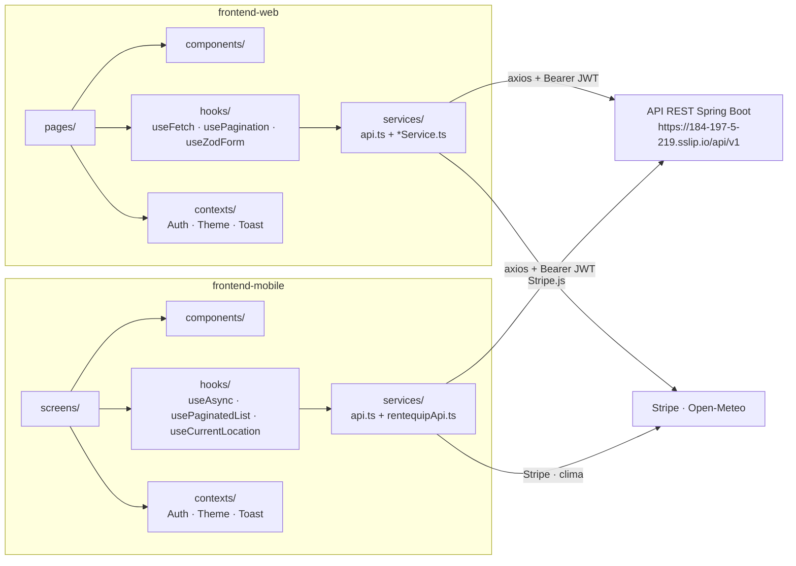

# RentEquip — Marketplace B2B de Alquiler de Maquinaria de Construcción

**Curso:** CS 2031 — Desarrollo Basado en Plataforma<br>
**Docente:** Yarasca Moscol, Julio Eduardo<br>
**Lima, Perú — 2026**

**Integrantes:**

| Integrante | Código |
|---|---|
| Ayala Vega, Valeria Isabel | 202310180 |
| Cadenas Hidalgo, Anthony Darian | 202510031 |
| Ramos Calderón, Mary Sofía | 202510158 |
| Rodrigo Corzo, Ernesto | 202310441 |
| Rojas Llanos, Sergio | 202410758 |

**Repositorio frontend (web + móvil):** https://github.com/sergio453LOL/FrontendRentequipV2<br>
**Repositorio backend:** https://github.com/sergio453LOL/BackendRentequipV2<br>
**Web en vivo:** https://sergio453lol.github.io/FrontendRentequipV2/<br>
**API en vivo:** https://184-197-5-219.sslip.io/swagger-ui.html<br>
**Evidencias de Deployment AWS y Swagger:** https://drive.google.com/drive/u/3/folders/1xaAGR4s1PUR31v4fTu4G2omBxdpoc3hD

---

## Índice

1. [Introducción](#1-introducción)
2. [Funcionalidades](#2-funcionalidades)
3. [Tecnologías Utilizadas](#3-tecnologías-utilizadas)
4. [Arquitectura](#4-arquitectura)
5. [Web — Cobertura de la Rúbrica](#5-web--cobertura-de-la-rúbrica)
6. [Web — UI/UX](#6-web--uiux)
7. [Mobile — Cobertura de la Rúbrica](#7-mobile--cobertura-de-la-rúbrica)
8. [Deployment](#8-deployment)
9. [Instalación y Ejecución Local](#9-instalación-y-ejecución-local)
10. [GitHub & Management](#10-github--management)
11. [Conclusión](#11-conclusión)

---

## 1. Introducción

RentEquip conecta a empresas que tienen maquinaria pesada parada con contratistas que la necesitan por días o semanas. Este repositorio contiene los dos clientes de la Fase 2, que consumen **exclusivamente** la API REST en Spring Boot del [repositorio backend](https://github.com/sergio453LOL/BackendRentequipV2):

| Carpeta | Cliente | Stack |
|---|---|---|
| [`frontend-web/`](frontend-web/) | Aplicación web | React 19 + TypeScript + Vite + Tailwind |
| [`frontend-mobile/`](frontend-mobile/) | App móvil | React Native 0.88 + Expo SDK 58 + TypeScript |

La web tiene dos modos: **arrendatario** (busca, reserva y paga) y **arrendador** (publica su flota, confirma reservas y ve sus ingresos). La app móvil está pensada para la obra: buscar maquinaria cerca con el GPS, verla en el mapa y documentar la entrega y devolución con la cámara.

## 2. Funcionalidades

| Funcionalidad | Web | Móvil |
|---|:---:|:---:|
| Registro de empresa o persona con autocompletado SUNAT/RENIEC (RUC o DNI) | ✓ | ✓ |
| Login con JWT, refresh token y verificación en dos pasos (correo o SMS) | ✓ | ✓ |
| Catálogo con búsqueda (debounce), filtros por categoría, ciudad, precio, fechas y tipo de obra, y orden | ✓ | ✓ |
| Mapa de maquinaria cercana | ✓ (Leaflet) | ✓ (react-native-maps + GPS) |
| Ficha del equipo con galería, disponibilidad y calificación | ✓ | ✓ |
| Clima de la obra (Open-Meteo) | | ✓ |
| Reserva con selección de fechas y cálculo del total | ✓ | ✓ |
| Pago con tarjeta (Stripe, modo test) | ✓ | ✓ |
| Comprobante en PDF descargable | ✓ | |
| Envío del comprobante por correo, WhatsApp o SMS | ✓ | ✓ |
| Seguimiento y cambio de estado de la reserva | ✓ | ✓ |
| Línea de tiempo animada de la reserva | ✓ | |
| Negociación de precio (ofertas y contraofertas) | ✓ | |
| Alquiler con opción de compra | ✓ | |
| Fotos de entrega y devolución con cámara y GPS | | ✓ |
| Mi flota: publicar, editar y eliminar maquinaria con fotos | ✓ | ✓ |
| Dashboard del arrendador con gráficos e ingresos | ✓ | ✓ |
| Administración de categorías (solo ADMIN) | ✓ | ✓ |
| Reseñas de 1 a 5 estrellas | ✓ | ✓ (promedio) |
| Notificaciones in-app con contador | ✓ | |
| Asistente IA que recomienda maquinaria del catálogo | ✓ | ✓ |
| Idiomas español, inglés y chino | ✓ | ✓ |
| Modo claro / oscuro | ✓ | ✓ |
| Precios en soles y dólares | ✓ | |

## 3. Tecnologías Utilizadas

| Capa | Web | Móvil |
|---|---|---|
| Framework | React 19 + Vite | React Native 0.88 + Expo SDK 58 |
| Lenguaje | TypeScript | TypeScript |
| Routing / navegación | React Router 7 | React Navigation 7 (stack + tabs) |
| Cliente HTTP | axios con interceptores | axios con interceptores |
| Formularios | React Hook Form + Zod | React Hook Form + Zod |
| Estilos | Tailwind CSS, Lucide icons, Framer Motion | StyleSheet con tema, Expo Vector Icons |
| Estado global | Context API (`AuthContext`, `ThemeContext`, `ToastContext`) | Context API (`AuthContext`, `ThemeContext`, `ToastContext`) |
| Tokens | Access token en memoria, refresh token en `sessionStorage` | `expo-secure-store` (Keychain / Keystore) |
| Pagos | Stripe.js + React Stripe | Tokens de prueba de Stripe |
| Mapas | Leaflet + React Leaflet | react-native-maps |
| Sensores | — | `expo-location`, `expo-camera`, `expo-image-picker` |
| Otros | `@react-pdf/renderer` (comprobantes), i18next | NetInfo (sin conexión), i18next |
| Lint | oxlint | ESLint (expo lint) |

## 4. Arquitectura



Las dos apps siguen la misma separación en capas:

- **services/** — el único lugar que habla HTTP. `api.ts` crea la instancia de axios con `baseURL` desde variables de entorno, `Content-Type` por defecto e interceptores. Un archivo por recurso (`equipmentService`, `reservationService`, `paymentService`…). Las rutas viven en `endpoints.ts`.
- **hooks/** — lógica reutilizable sin UI: carga con reintentos, paginación, formularios, debounce, ubicación.
- **contexts/** — estado global: sesión, tema y toasts.
- **pages/** y **screens/** — contenedores que componen hooks y componentes.
- **components/** — presentacionales y reutilizables, agrupados por dominio (`common`, `equipment`, `reservations`, `payments`, `dashboard`…).

## 5. Web — Cobertura de la Rúbrica

| Criterio | Implementación |
|---|---|
| **3.1 Integración con el backend** | [`services/api.ts`](frontend-web/src/services/api.ts): axios con `baseURL` (`VITE_API_URL`), headers por defecto e interceptores. El de request pone `Authorization: Bearer`. El de response renueva el token en un 401 (un solo refresh compartido entre peticiones simultáneas) y cierra la sesión si falla. Usa **GET, POST, PUT, PATCH y DELETE**. **Tokens seguros**: el access token vive solo en memoria y el refresh token en `sessionStorage`, que se borra al cerrar la pestaña (nada queda en `localStorage`). **AbortController** en `useFetch` y en las búsquedas del catálogo, así una petición vieja nunca pisa a una nueva ni deja fugas. Sin datos hardcodeados: todo sale de la API. |
| **3.2 Componentes y arquitectura** | 79 componentes en `components/` (30 genéricos en `common/`: `Button`, `Input`, `Select`, `Modal`, `ConfirmDialog`, `Pagination`, `EmptyState`, `ErrorState`, `SkeletonLoader`, `StatusBadge`…). 16 custom hooks (`useAuth`, `useFetch`, `useMutation`, `usePagination`, `useZodForm`, `useDebounce`, `useQueryParam`, `useOnlineStatus`, `useSessionTimeout`…). `useState`, `useEffect`, `useContext`, `useReducer`, `useMemo` y `useCallback`. Props tipadas con TypeScript. |
| **3.3 Routing y navegación** | Rutas centralizadas en [`routes/`](frontend-web/src/routes/) (`paths.ts`, `AppRoutes.tsx`). Ruta dinámica `/equipment/:id` y query params (`?q=`, `?categoryId=`, `?page=`, `?size=`, `?reservar=1`). `PrivateRoute` protege las rutas por sesión y por rol (`/categories` solo ADMIN, `/equipment/new` solo ADMIN y MANAGER). Todas las páginas con `React.lazy` + `Suspense`. `useNavigate` para navegación programática, página 404 y breadcrumbs en `PageHeader`. |
| **3.4 Errores, carga y validaciones** | `ErrorBoundary` global. [`utils/apiError.ts`](frontend-web/src/utils/apiError.ts) traduce 400, 401, 403, 404, 409, 422, 429 y 5xx a mensajes amigables en el idioma del usuario. Reintentos automáticos (1 s y 2 s) en errores de red y 5xx. Skeletons y spinners. React Hook Form + Zod con validación en tiempo real. Toasts de éxito y error. Botones deshabilitados durante el envío. Estados vacíos con call-to-action y banner sin conexión. |

## 6. Web — UI/UX

| Criterio | Implementación |
|---|---|
| **4.1 Diseño visual** | Tailwind CSS con una paleta industrial (amarillo maquinaria y asfalto), tipografía consistente e iconos Lucide. Responsive en móvil, tablet y escritorio, con sidebar colapsable. Animaciones sutiles con Framer Motion. **Modo oscuro** y pantalla completa. |
| **4.2 Experiencia de usuario** | Landing con buscador rápido y cotizador. Búsqueda con debounce, filtros y orden. Registro en pasos con indicador de progreso. Formularios con labels, placeholders y hints. `ConfirmDialog` antes de eliminar o cancelar. Alt text en imágenes y navegación por teclado. Tooltips, mensajes contextuales y estados vacíos con acción. |
| **4.3 Vistas** | 14 vistas: landing, login, registro, panel (dashboard con gráficos), catálogo, detalle del equipo, publicar equipo, mi flota, mis reservas, ofertas, compras, perfil, categorías y 404. |
| **4.4 Paginación** | Seis listados paginados contra endpoints paginados del backend (catálogo, flota, reservas, ofertas, compras y dashboard). El componente `Pagination` tiene anterior/siguiente y números de página, muestra "X–Y de Z resultados" y permite elegir 10, 25, 50 o 100 por página. `usePagination` guarda `page` y `size` en la URL para compartir el enlace. |

## 7. Mobile — Cobertura de la Rúbrica

| Criterio | Implementación |
|---|---|
| **2.1 Integración con el backend** | [`services/api.ts`](frontend-mobile/src/services/api.ts): axios con `baseURL` (`EXPO_PUBLIC_API_URL`), `Authorization: Bearer`, refresh automático en 401 y logout si falla. JWT en **expo-secure-store**. Usa GET, POST, PUT (categorías), PATCH (editar equipo, estado de reserva), DELETE (equipo, categoría) y multipart (fotos). |
| **2.2 Arquitectura** | `screens/`, `components/`, `services/`, `hooks/`, `contexts/`, `navigation/`, `types/`, `utils/`, `theme/`, `i18n/`. Context API y custom hooks (`useAsync`, `usePaginatedList`, `useCurrentLocation`, `useAction`, `useDebounce`, `useToast`). |
| **2.3 Sensores y API externa** | **GPS** (`expo-location`): maquinaria cerca y ubicación de cada foto. **Cámara** (`expo-camera`): fotos de entrega y devolución, con linterna y cámara frontal. **Mapa** con pines y "Buscar en esta zona". **APIs externas**: clima de la obra con **Open-Meteo** y pagos con **Stripe**. Fallbacks: sin GPS se usa Lima; sin cámara se elige de la galería; con permisos denegados se ofrece abrir Ajustes. |
| **2.4 Errores y carga** | `ActivityIndicator`, pull-to-refresh y scroll infinito. Mensajes en español por código HTTP, reintentos en errores de red y 5xx, aviso sin conexión con NetInfo, toasts, botones bloqueados durante las peticiones y validación con React Hook Form + Zod. |

## 8. Deployment

| Pieza | Plataforma | Cómo se configura |
|---|---|---|
| Web | **GitHub Pages** — https://sergio453lol.github.io/FrontendRentequipV2/ | [`.github/workflows/deploy-pages.yml`](.github/workflows/deploy-pages.yml) compila y publica en cada push a `main`. `VITE_API_URL` y `VITE_STRIPE_PUBLISHABLE_KEY` llegan como variables del repositorio. Copia `index.html` a `404.html` para que recargar una ruta profunda funcione. |
| Móvil | **Expo / EAS Build** — proyecto `@sergiorojas/rentequip` | `EXPO_PUBLIC_API_URL` y `EXPO_PUBLIC_STRIPE_PUBLISHABLE_KEY` como variables de entorno de EAS. `eas build -p android --profile preview` genera el APK instalable. |
| API | **AWS EC2 + RDS** — https://184-197-5-219.sslip.io | Caddy con HTTPS (Let's Encrypt) y Elastic IP. Ver el [README del backend](https://github.com/sergio453LOL/BackendRentequipV2#evidencias-de-deployment). |

Toda la cadena va por HTTPS, sin contenido mixto, y el backend permite el origen de GitHub Pages en CORS. Las URLs y claves llegan por variables de entorno; ninguna clave secreta vive en el código.

> La API corre en AWS Academy: se enciende con **Start Lab** y tarda unos 3 minutos en responder. La URL no cambia entre sesiones.

## 9. Instalación y Ejecución Local

**Requisitos:** Node.js 22 y el [backend](https://github.com/sergio453LOL/BackendRentequipV2) corriendo (`docker compose up -d`).

**Web**

```bash
git clone https://github.com/sergio453LOL/FrontendRentequipV2.git
cd FrontendRentequipV2/frontend-web
cp .env.example .env      # VITE_API_URL=http://localhost:8080/api/v1
npm install
npm run dev
```

**Móvil**

```bash
cd FrontendRentequipV2/frontend-mobile
cp .env.example .env      # EXPO_PUBLIC_API_URL=http://<IP-de-tu-PC>:8080/api/v1
npm install
npx expo start
```

Escanea el QR con Expo Go. Más detalle en [`frontend-web/README.md`](frontend-web/README.md) y [`frontend-mobile/README.md`](frontend-mobile/README.md).

**Comandos de verificación**

| Comando | Qué hace |
|---|---|
| `npm run build` (web) | Tipos + build de producción |
| `npm run lint` (web) | oxlint |
| `npm run typecheck` (móvil) | `tsc --noEmit` |
| `npm run lint` (móvil) | ESLint |

## 10. GitHub & Management

Conventional Commits (`feat(web)`, `feat(mobile)`, `fix`, `chore(deploy)`), ramas por funcionalidad y Pull Requests revisados antes de mergear a `main` (por ejemplo, el rediseño del catálogo y las reseñas, que trabajó Ernesto Corzo). El `.gitignore` excluye `.env`, `node_modules/` y `dist/`: no hay claves en el historial. GitHub Actions despliega la web en cada push a `main`.

## 11. Conclusión

Los dos clientes comparten la misma arquitectura en capas, el mismo manejo de errores y las mismas validaciones con Zod, así que una regla de negocio se escribe igual en web y en móvil. Lo más valioso que aprendimos fue centralizar todo el acceso HTTP en una sola instancia de axios: el refresh de tokens, la traducción de errores y los reintentos se resuelven una vez y todas las pantallas lo heredan. La web cubre el flujo completo del arrendatario y del arrendador; el móvil agrega lo que solo un teléfono puede dar en la obra: ubicación, mapa y fotos de la máquina.
